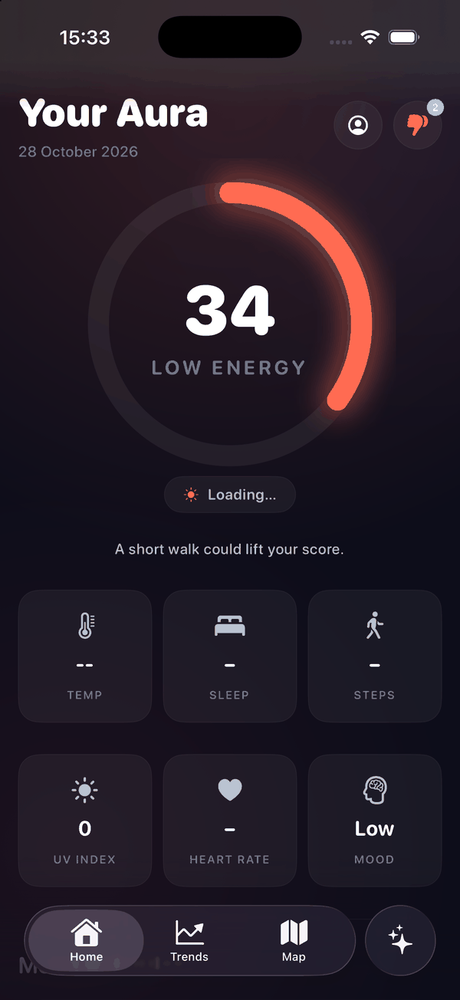
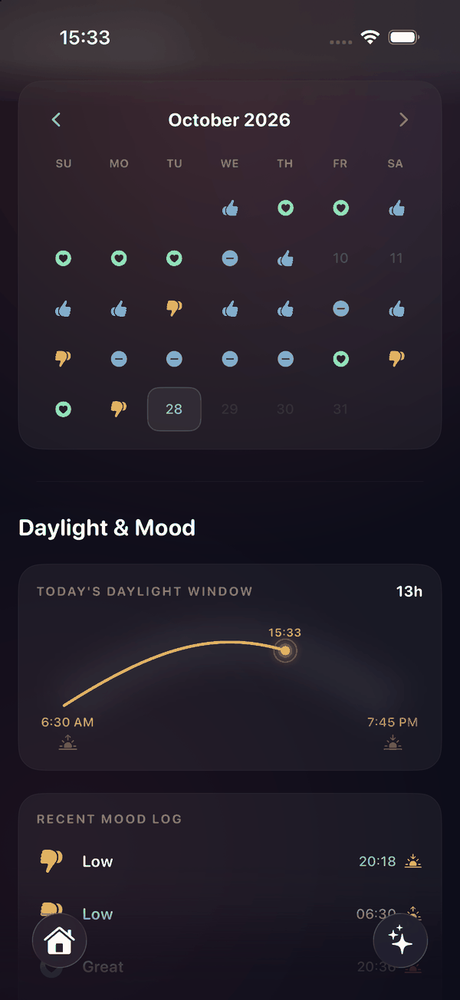
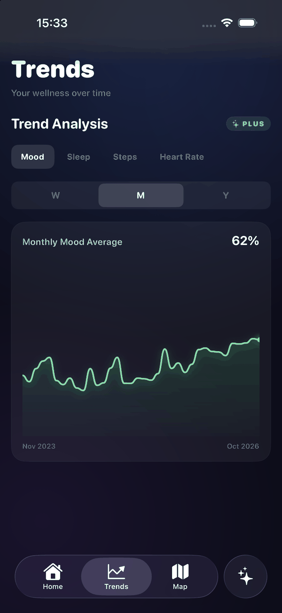
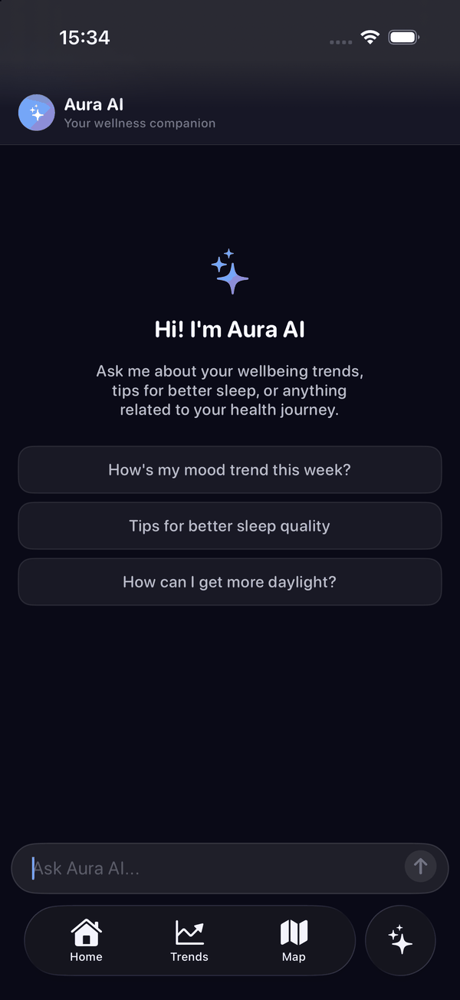

# Aura

Aura is an iOS well-being companion that turns everyday signals (mood, sleep, activity, sunlight and weather) into a single, interpretable **Aura Score**. It is built entirely in SwiftUI and designed around the idea that well-being is dynamic: what matters in the morning is not what matters at night.

<p align="center">
  
  <br>
  <sub>Walkthrough on the iOS simulator with the demo account (<a href="docs/media/demo.mp4">MP4 version</a>)</sub>
</p>

## Overview

Most wellness apps show a wall of raw numbers. Aura instead composes those numbers into one score that reflects how well-being actually works: circadian rhythms, diminishing returns, and the coupling between sleep and mood. Around that score it adds mood check-ins, seasonal-light (SAD) awareness, trend charts, and an optional AI wellness assistant.

## Features

- **Aura Score**: a composite daily well-being score built from sleep, activity, mood, UV/sunlight and resting heart rate, using time-of-day (circadian) weighting and diminishing-returns curves.
- **Mood check-ins**: a lightweight morning/evening mood log (max two per day) with a calendar view and historical snapshots.
- **Health integration**: reads sleep, steps and heart rate from Apple Health (HealthKit).
- **Weather and sunlight**: current conditions, UV index, sunrise/sunset and daily sunlight hours from a weather API, with a sun-arc visualization.
- **SAD tracker**: seasonal-affective-disorder oriented view that highlights daily light exposure.
- **Trends**: interactive line and bar charts for mood, sleep, steps and heart rate over time.
- **Demo account**: create an account with the email `demo@aura.app` (any password of 6+ characters) and the app seeds three years of synthetic mood entries and daily snapshots (`HistoricalDataGenerator`), so that trends and the calendar are populated for demonstration purposes. Regular accounts start empty.
- **AI assistant**: an optional conversational wellness assistant (OpenAI-compatible chat endpoint) that can reference the user's own patterns.
- **Accounts**: Sign in with Apple and a local email/password option (passwords stored only as SHA-256 hashes on device).
- **Smart reminders**: local notifications for mood check-ins.
- **Premium paywall**: a mock paywall that gates trends and the AI assistant (no real transactions).

## Screenshots

<table>
  <tr>
    <td align="center"></td>
    <td align="center"></td>
    <td align="center"></td>
    <td align="center"></td>
  </tr>
  <tr>
    <td align="center"><sub><b>Aura Score</b><br>Composite daily score with pillar cards</sub></td>
    <td align="center"><sub><b>Mood &amp; daylight</b><br>Mood calendar, sun arc and mood log</sub></td>
    <td align="center"><sub><b>Trends</b><br>Mood, sleep, steps and heart rate over time</sub></td>
    <td align="center"><sub><b>Aura AI</b><br>Conversational wellness assistant</sub></td>
  </tr>
</table>

Screenshots were taken on the iOS simulator using the demo account, so the history is synthetic and no live weather or HealthKit data is shown.

## Tech stack

| Area          | Technology                                             |
| ------------- | ------------------------------------------------------ |
| UI            | SwiftUI                                                |
| Language      | Swift 5                                                |
| Health data   | HealthKit                                              |
| Location      | CoreLocation                                           |
| Maps          | MapKit                                                 |
| Auth          | Sign in with Apple (AuthenticationServices), CryptoKit |
| Notifications | UserNotifications                                      |
| Persistence   | UserDefaults (Codable snapshots)                       |
| Networking    | URLSession (async/await)                               |
| Target        | iOS 26.2+ (iPhone)                                     |

## Architecture

The codebase follows an MVVM structure. UI is declarative SwiftUI; observable view models own the state and side effects; services encapsulate persistence, data generation and system managers.

```
aura/
├── App/            # App entry point (auraApp.swift)
├── Models/         # Domain and Codable types (Mood, DailySnapshot, AuraScore, ...)
├── ViewModels/     # ObservableObject state (Auth, Weather, Health, Chat)
├── Services/       # Persistence, notifications, data generation, accounts
├── Views/          # Screens (Home, Trends, Map, Chat, Calendar, Paywall, ...)
├── Components/     # Reusable UI (rings, cards, charts, sun arc, map)
├── Theme/          # Design tokens, backgrounds, button styles
├── Utilities/      # Formatters and haptics
└── Assets.xcassets # App icon and colors
```

See [docs/TECHNICAL_WRITEUP.md](docs/TECHNICAL_WRITEUP.md) for the design rationale and the Aura Score algorithm in detail.

## Getting started

### Requirements

- Xcode 26 or later (the project targets the iOS 26.2 SDK)
- An iOS 26.2+ simulator or device
- (Optional) API keys for live weather and AI chat

### Build

1. Clone the repository and open `aura.xcodeproj` in Xcode.
2. In **Signing & Capabilities**, select your own development team and, if needed, change the bundle identifier (`com.simone.aura`) to one you own.
3. Select an iOS simulator (or a signed device).
4. Build and run.

HealthKit data is only available on a real device; on the simulator the health-based parts of the score fall back to empty values.

**Sign in with Apple** requires the *Sign in with Apple* capability, which is only available with a paid Apple Developer Program membership. It is not enabled in the project by default; the local email/password login works without it.

The app runs without any API keys: mood tracking, the Aura Score and the health/calendar features all work locally. Only the live weather and the AI assistant require keys.

### API keys (optional)

Two placeholders are present in the source and must be replaced to enable the corresponding features:

- **Weather**: `ViewModels/WeatherViewModel.swift`, replace `YOUR_WEATHERAPI_KEY` with a free key from [weatherapi.com](https://www.weatherapi.com).
- **AI assistant**: `ViewModels/AuraChatAIViewModel.swift`, replace `YOUR_GROQ_API_KEY` with a free key from [console.groq.com](https://console.groq.com/keys).

Keys are intentionally not included in the repository. `Secrets.swift` and `.env` are already git-ignored if you prefer to move the keys out of source.

## Privacy

All health and mood data is processed on device and stored locally in `UserDefaults`. Health data is read through HealthKit with the user's explicit permission. When the AI assistant is enabled, chat messages are sent to the configured third-party endpoint; when disabled, no data leaves the device.

## Disclaimer

Aura is a prototype for educational and portfolio purposes. It is not a medical device and does not provide medical advice or diagnosis. Always consult a qualified professional for health concerns.

## Team

Aura was designed and built by:

- Alexandre Benjamin Cambier
- Simone Cobuccio
- Giancarlo Ferrara
- Davide Tissino

## License

Released under the [MIT License](LICENSE).
